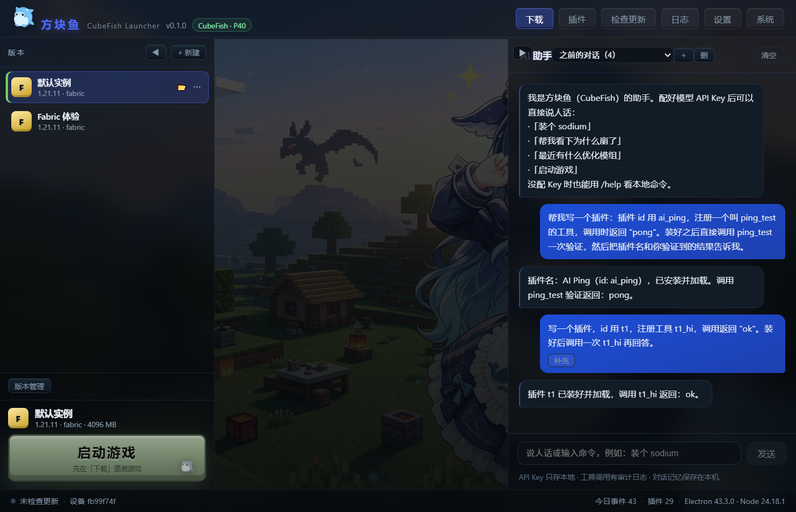
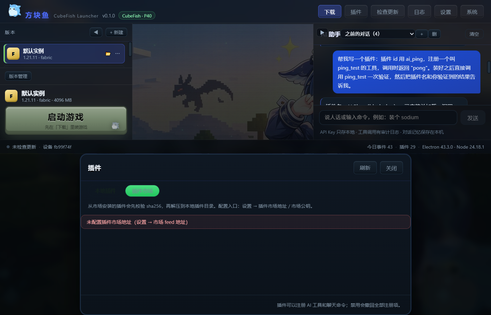
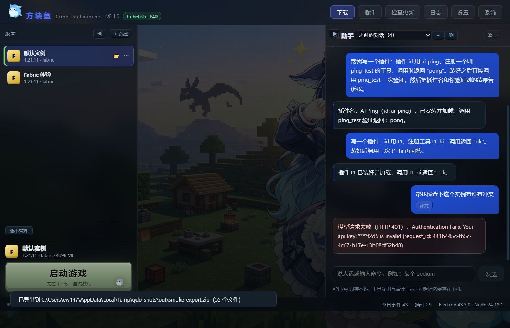

# 方块鱼 / CubeFish

> AI 驱动的 Minecraft 启动器 —— 不是「套壳启动器 + 聊天框」，而是**一个能真正操作启动器的 AI agent**：它能查状态、装模组、修冲突、写插件，甚至改自己的源码。

[](LICENSE)
[](https://github.com/zhaoxi737/CubeFish/actions)



## 它和别的启动器有什么不一样

| 常见启动器 | 方块鱼 |
|---|---|
| 报错了让你自己看日志 | AI 读日志、定位原因、**直接修** |
| 模组版本冲突只能手动换 | `fix_mod_conflict` 一步换到兼容版本 |
| 没有的功能只能等作者更新 | AI **自己写插件**补能力，当场安装生效 |
| 插件只能注册命令 | 插件可以注册 AI 工具、聊天命令、**顶栏按钮** |
| 聊天机器人只会聊天 | 40+ 工具，真的能操作启动器 |

## 功能

**AI 助手（核心）**
- 自然语言操作：装模组、看崩溃、调设置、启动游戏
- 实时显示「正在调用什么工具」，可随时**停止**
- 多对话（可新建/切换/删除）、**补充上一条**消息
- 跨会话记忆（`remember` / `recall`）
- 子助手并行（最多 3 层、5 路并行）
- 一键盘「源码回滚」：AI 改坏了能一键恢复

**启动器本体**
- 实例隔离（每个实例独立 mods / 存档 / 配置，可关）
- 下载中心：Modrinth + CurseForge 双源、分页、逐文件进度
- 整合包（`.mrpack` / CurseForge）一键安装
- 冲突检查、崩溃归因、一键修复
- Java 管理（探测 / 选择 / 手动添加 / 下载官方运行时）
- 高性能显卡一键开关（写 Windows 显卡偏好，不用进 NVIDIA 面板）
- 个性化：主题色、背景图、标题文字
- 语音：麦克风录音 + 喇叭朗读（可让 AI 说话）
- 插件沙箱：进程隔离、失败自动回滚

## 截图

| 下载中心 | 插件 / AI 能力 |
|---|---|
|  |  |

## 快速开始

1. 到 [Releases](https://github.com/zhaoxi737/CubeFish/releases) 下载 `CubeFish-<版本>-win32-x64.zip`
2. 解压到任意目录，双击 `CubeFish.exe`
3. 首次启动会创建实例；在「下载」里装游戏版本和加载器
4. 想用 AI：设置 → AI 助手 → 填 DeepSeek API Key（或任意 OpenAI 兼容地址）

> 系统要求：Windows 10/11 x64。游戏本身需要 Java，启动器会自动下载或让你选。

### 配置 AI

- 默认走 DeepSeek：`https://api.deepseek.com/v1`
- 推荐模型：`deepseek-chat`（支持工具调用）或 `deepseek-v4-pro`（更强）
- Key 只保存在你本机（`%APPDATA%\QDOQMC\settings.json`）
- **危险能力默认关闭**：AI 执行任意命令 / 改源码 / 重建，需要在设置里显式开启

## 从源码构建

```bash
npm install          # 安装依赖
npm run build        # 编译（esbuild）
npm start            # 开发模式启动
npm run package      # 打便携包到 dist/
npm run typecheck    # 类型检查
```

## 插件开发

插件是 `<数据目录>/plugins/<id>/` 下的 `plugin.json` + `index.mjs`，导出 `apply(api)`：

```js
export function apply(api) {
  api.registerTool({
    name: 'my_tool',
    description: '这个工具做什么',
    parameters: { type: 'object', properties: {}, additionalProperties: false },
    async handler() {
      return { ok: true, summary: '结果' }
    },
  })
  // 还能 registerCommand / registerButton / api.fetch / api.storage / api.callTool
}
```

详见 [docs/PLUGINS.md](docs/PLUGINS.md)。插件在独立进程沙箱里运行，崩溃不会拖垮启动器。

## 常见问题

**AI 说「没有这个能力」？**
先看设置里模型是否支持工具调用（推荐 `deepseek-chat`）。启动器会要求它先调 `list_tools` 再回答。

**AI 要我自己配 Key，贵吗？**
一次普通对话几分钱以内。不用 AI 时启动器完全离线可用。

**误删了 / 改坏了？**
顶栏「系统」→「源码回滚」可恢复启动器源码；游戏文件删除前会确认。

## 许可

- 代码：[GPL-3.0](LICENSE)。你可以自由使用、修改、分发，但衍生作品必须同样开源。
- 名称与 Logo：见 [TRADEMARK.md](TRADEMARK.md)。**Fork 请改名**，不要用「方块鱼 / CubeFish」发布。

## 免责声明

本项目是第三方启动器，**与 Mojang、Microsoft、CurseForge 无任何关联**，不包含、不分发任何 Minecraft 官方资源（游戏文件均在使用时从官方地址下载）。
